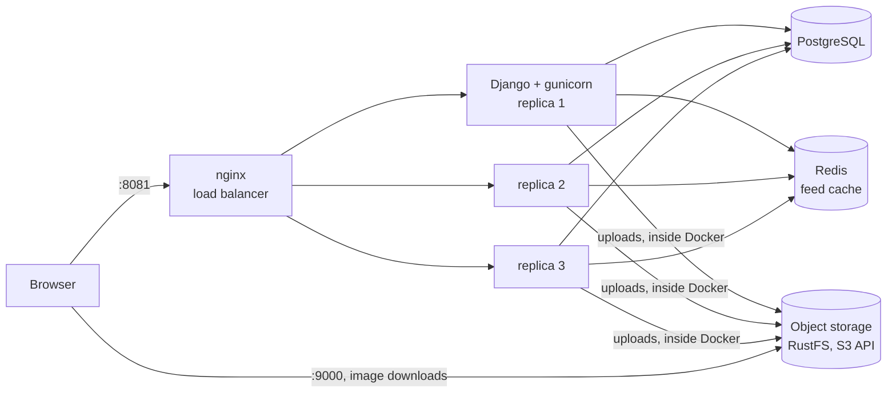
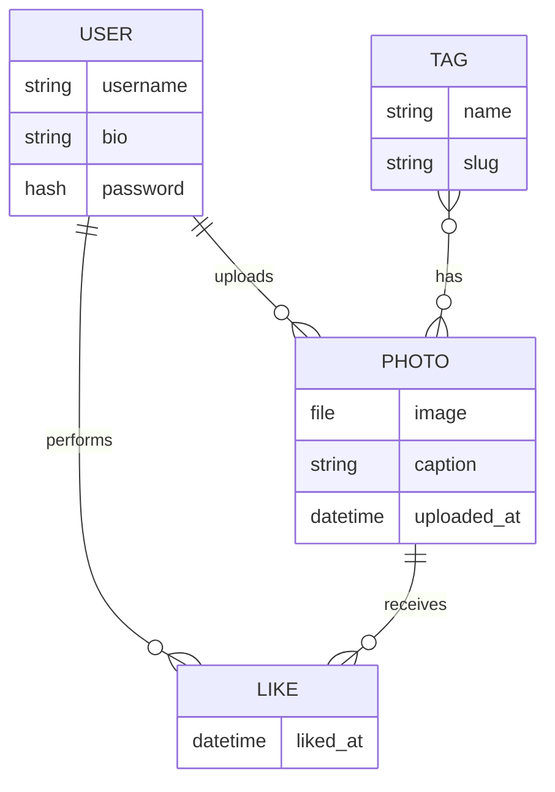

# Photo Application Demo

This repo contains a photo-sharing application for demonstrative/learning purposes of horizontally scalable web applications.


It runs as a multi-container Docker Compose stack, supporting multiple app replicas behind an nginx load balancer, PostgreSQL for data, Redis for caching, and S3-compatible object storage for photos.

## Get Started

**Requirements**: Docker

```bash
# 1. Clone repositories
git clone <repository-url>
cd <repository-folder>

# 2. Create your .env file using .env.example and update passwords
cp .env.example .env

# 3. Build and start everything
docker compose up -d --build
```

## Architecture



| Service | Image | Purpose | Reachable from your machine |
|---|---|---|---|
| `lb` | `nginx:alpine` | Load balances requests across app replicas and serves `/static/` | `http://localhost:8081` |
| `app` | built from `Dockerfile` | Django served by gunicorn (3 replicas by default) | No (internal only) |
| `migrate` | same image as `app` | One-shot job: migrations, `collectstatic`, superuser creation | No |
| `db` | `postgres:15-alpine` | Application database | No |
| `redis` | `redis:alpine` | Cache for the photo feed | No |
| `minio` | `rustfs/rustfs` | S3-compatible photo storage (service name kept as `minio`) | API `:9000`, console `:9001` |
| `createbucket` | `amazon/aws-cli` | One-shot job: creates the bucket and applies the read policy | No |

## Data Model



## Access

| URL | What |
|---|---|
| http://localhost:8081 | The application |
| http://localhost:8081/admin/ | Django admin (log in with the superuser from `.env`) |
| http://localhost:9001 | Object storage console (log in with `MINIO_ROOT_USER` / `MINIO_ROOT_PASSWORD`) |

## Configuration

All configuration lives in `.env`, `.env.example` lists every variable with placeholder values. Docker Compose and the Django containers both read this one file.

| Variable | Purpose |
|---|---|
| `POSTGRES_DB`, `POSTGRES_USER`, `POSTGRES_PASSWORD` | Database name and credentials. Used by the `db` container *and* by Django |
| `DB_HOST`, `DB_PORT` | Where Django finds Postgres. |
| `MINIO_ROOT_USER`, `MINIO_ROOT_PASSWORD` | Storage credentials, shared by the storage server, the bucket job and Django |
| `MINIO_BUCKET` / `AWS_STORAGE_BUCKET_NAME` | Bucket name for photos (keep both identical) |
| `AWS_S3_ENDPOINT_URL` | How Django reaches storage from inside Docker: `http://minio:9000` |
| `AWS_S3_CUSTOM_DOMAIN` | Public address the *browser* uses for images, e.g. `localhost:9000/photo-app-media` |
| `DJANGO_SUPERUSER_USERNAME`, `DJANGO_SUPERUSER_PASSWORD` | Admin account created automatically on first start |


## Testing

Running tests requires installing dependencies locally and running Photo Application in standalone mode (disable use of external database and caching)

```bash
# 1. Create virtual environment
cd app
python -m venv env
.\env\Scripts\activate

# 2. Install dependencies
pip install -r requirements.txt

# 3. Enable standalone mode
$env:STANDALONE_MODE="True"

# 4. Run tests
python manage.py test
```